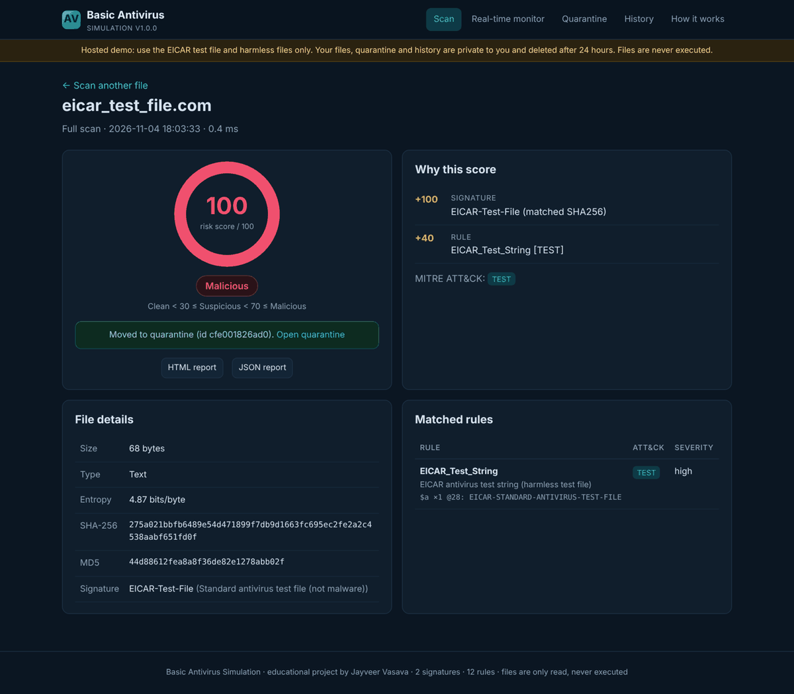
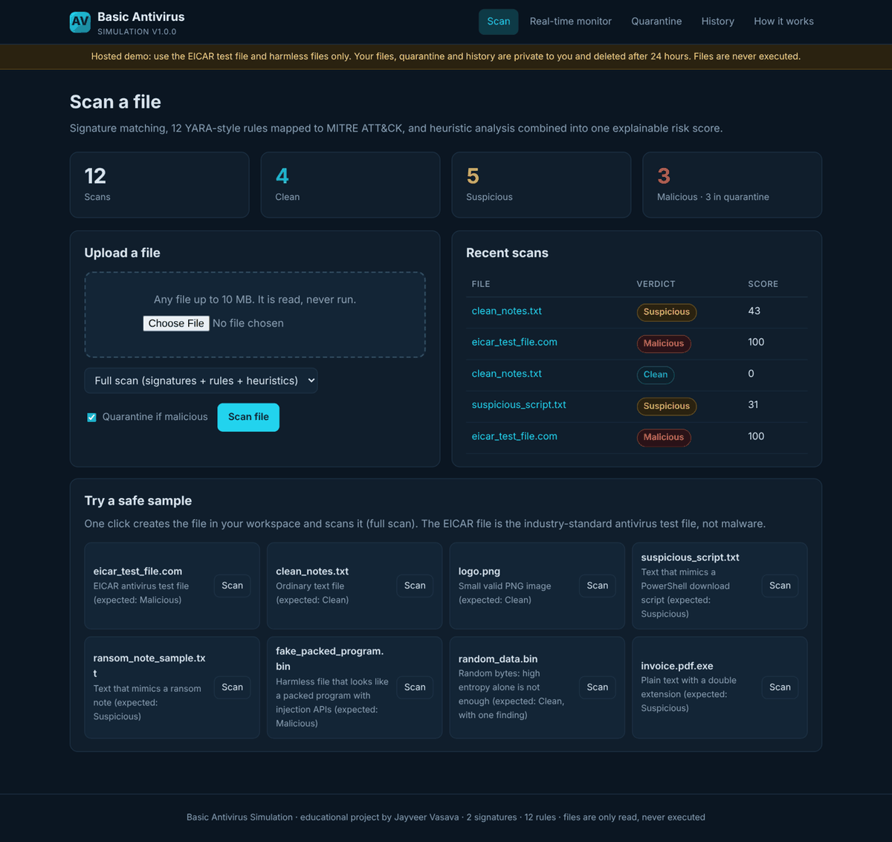
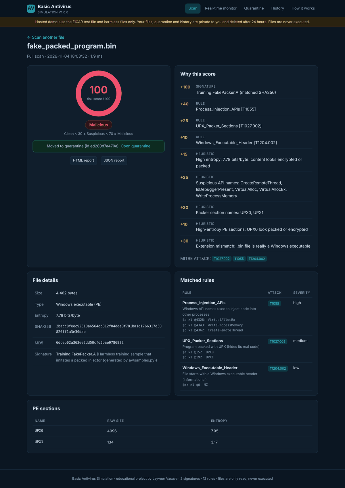
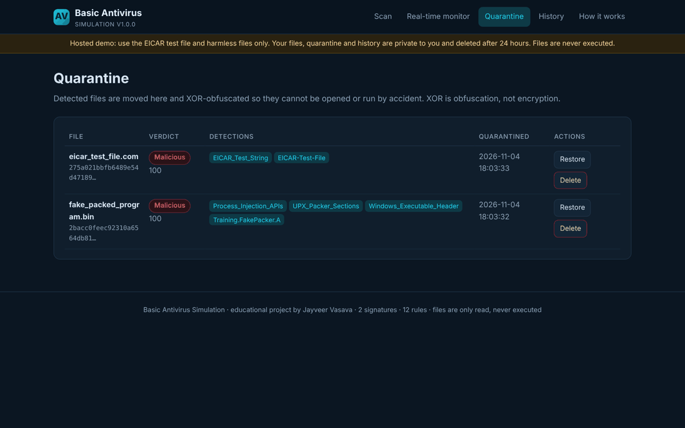
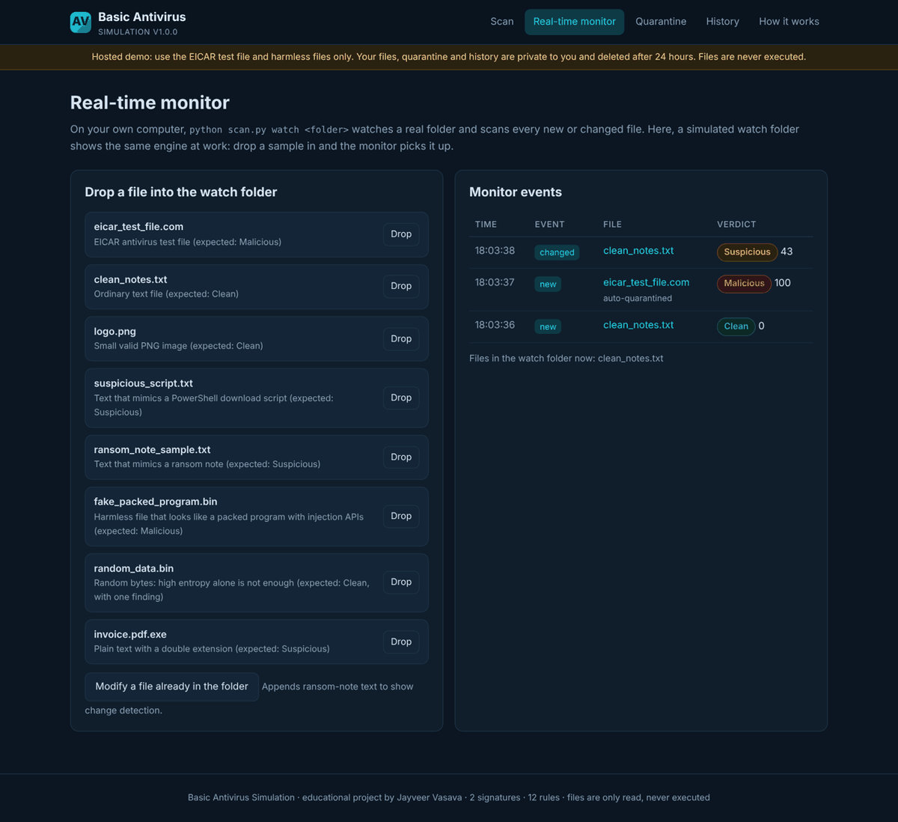
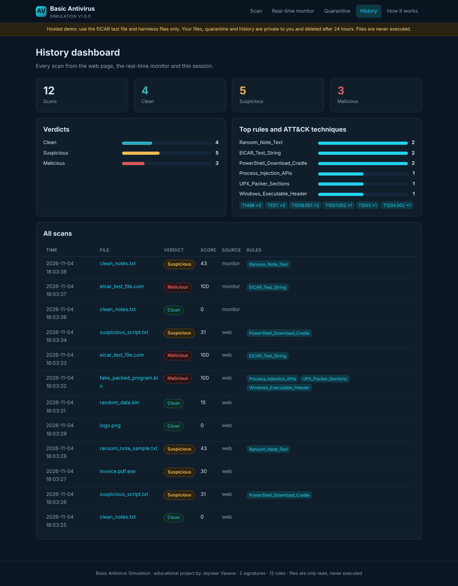
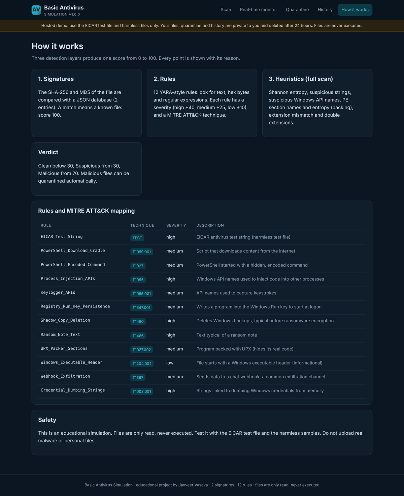
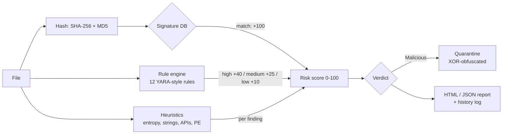

# Basic Antivirus Simulation

[](https://github.com/jayveerv/basic-antivirus-simulation/actions/workflows/tests.yml)


An educational antivirus engine written in Python. It shows how a real antivirus decides that a file is dangerous: **signature matching**, **YARA-style rules mapped to MITRE ATT&CK**, and **heuristic analysis**, combined into one explainable 0-100 risk score. It also has **quarantine**, **real-time folder monitoring**, **HTML/JSON reports**, a **command-line scanner** and a **Flask web demo**.

Built as a SkillFied Mentor cyber security internship project by **Jayveer Vasava** (M.Tech Cyber Security, Parul University).

> **Safe by design.** Files are only read, never executed. It is tested with the EICAR test file and harmless samples only. No real malware is used, stored or generated.

**Live demo:** https://basic-antivirus-simulation.onrender.com (free hosting: the first visit after a quiet period can take up to a minute)



---

## Features

| # | Feature | What it does |
|---|---|---|
| 1 | Signature scanning | SHA-256 and MD5 of every file compared with a JSON signature database (`data/signatures.json`) |
| 2 | Rule-based detection | 12 YARA-style rules (`rules/default.yar`) with text, hex and regex patterns; each rule has a severity and a MITRE ATT&CK technique |
| 3 | Heuristic analysis | Shannon entropy, suspicious strings, suspicious Windows API names, PE section parsing, packer hints (UPX, high-entropy sections), extension mismatch, double extensions |
| 4 | Explainable risk score | 0-100 score; every point is listed with its reason. Clean < 30, Suspicious 30-69, Malicious 70+ |
| 5 | Scan modes | Single file or whole folder; **quick** (signatures + rules) or **full** (+ heuristics) |
| 6 | Quarantine | Detected files are moved away and XOR-obfuscated; restore or permanently delete them |
| 7 | Real-time monitoring | Watches a folder and scans every new or changed file, with optional auto-quarantine |
| 8 | Reports | HTML and JSON report per scan, plus a scan history log |
| 9 | Command-line tool | `scan.py` with `scan`, `watch`, `quarantine`, `history` and `samples` commands |
| 10 | Web demo | Upload a file or one-click a sample; result page, quarantine, history dashboard, simulated real-time monitor |

### How is this different from my Static File Inspector?

[static-file-inspector](https://github.com/jayveerv/static-file-inspector) produces a one-off analysis report for a single file. This project is a **scanning engine**: a signature database, a rule engine, a scoring model with verdicts, folder scans, quarantine with restore, real-time monitoring and scan history.

---

## Screenshots

| Home | Result: packed program |
|---|---|
|  |  |
| **Quarantine** | **Real-time monitor** |
|  |  |
| **History dashboard** | **How it works / ATT&CK mapping** |
|  |  |

---

## How it works



### Scoring

| Source | Points |
|---|---|
| Signature match (known file) | 100 |
| Rule: high / medium / low severity | 40 / 25 / 10 |
| High entropy (> 7.5 bits/byte, not a compressed format) | 15 |
| Suspicious API names | 5 each, max 25 |
| Suspicious strings (URLs, IPs, shells, crypto wallets, base64 blobs, run keys) | 3 each, max 15 |
| Packer section names (UPX0, .aspack, ...) | 20 |
| High-entropy PE sections | 10 |
| Extension mismatch (e.g. `.jpg` that is really an `.exe`) | 30 |
| Double extension (e.g. `invoice.pdf.exe`) | 30 |

The total is capped at 100. **Clean** < 30 &le; **Suspicious** < 70 &le; **Malicious**.

### Rules and MITRE ATT&CK mapping

| Rule | ATT&CK | Severity |
|---|---|---|
| EICAR_Test_String | test file | high |
| PowerShell_Download_Cradle | T1059.001 PowerShell | medium |
| PowerShell_Encoded_Command | T1027 Obfuscated Files or Information | medium |
| Process_Injection_APIs | T1055 Process Injection | high |
| Keylogger_APIs | T1056.001 Keylogging | medium |
| Registry_Run_Key_Persistence | T1547.001 Registry Run Keys | medium |
| Shadow_Copy_Deletion | T1490 Inhibit System Recovery | high |
| Ransom_Note_Text | T1486 Data Encrypted for Impact | high |
| UPX_Packer_Sections | T1027.002 Software Packing | medium |
| Windows_Executable_Header | T1204.002 Malicious File (informational) | low |
| Webhook_Exfiltration | T1567 Exfiltration Over Web Service | medium |
| Credential_Dumping_Strings | T1003.001 LSASS Memory | high |

### Rule syntax

Rules use a simplified YARA syntax and are parsed by `av/rules.py` (pure Python, no `yara-python` needed, so it installs on Windows without a compiler):

```
rule Process_Injection_APIs {
    meta:
        description = "Windows API names used to inject code into other processes"
        severity = "high"
        mitre = "T1055"
    strings:
        $a = "VirtualAllocEx"
        $b = "WriteProcessMemory"
        $c = "CreateRemoteThread"
    condition:
        2 of them
}
```

Supported: text strings with `nocase`, `wide`, `ascii`; hex strings with `??` wildcards; regular expressions `/.../i`; conditions `any of them`, `all of them`, `N of them`, `and`, `or`, `not`, brackets, `$a at 0`, `#a >= 3` (match count) and `filesize < N`.

---

## Quick start (Windows)

1. Install **Python 3.10 or newer** from [python.org](https://www.python.org/downloads/). During setup tick **"Add python.exe to PATH"**.
2. Download this repository (green **Code** button, then **Download ZIP**) and unzip it.
3. Double-click **`run.bat`**. The first run installs everything automatically, then shows a menu:

```
  1. Open the web app (http://127.0.0.1:5000)
  2. Create safe sample files and run a full scan
  3. Quick scan of a folder
  4. Real-time monitor (folder "watched")
  5. Show quarantine
  6. Show scan history
  7. Run unit tests
```

> Your own antivirus (e.g. Windows Defender) may react when the EICAR sample is created. That is expected: EICAR is the standard antivirus test file. The repository itself stores EICAR encoded, so downloading it is not flagged.

### Linux / macOS

```bash
./run.sh          # web app
./run.sh demo     # create samples and run a full scan
./run.sh watch    # real-time monitor of ./watched
./run.sh test     # unit tests
```

---

## Command-line usage

```bash
python scan.py samples demo_files                          # create safe test files
python scan.py scan demo_files                             # full scan of a folder
python scan.py scan demo_files --quick                     # quick scan (signatures + rules)
python scan.py scan demo_files --report both --quarantine  # HTML + JSON report, quarantine malicious files
python scan.py scan suspicious_script.txt -v               # one file, show every reason
python scan.py watch watched --quarantine                  # real-time monitor (Ctrl+C to stop)
python scan.py quarantine list
python scan.py quarantine restore <ID>                     # or: --to <path>
python scan.py quarantine delete <ID>
python scan.py history
```

Exit code is `1` when a malicious file is found, so the scanner can be used in scripts.

Example output:

```
Basic Antivirus Simulation v1.0.0 | full scan | 2 signatures, 12 rules

  Clean        0/100  clean_notes.txt
  Malicious  100/100  eicar_test_file.com
      +100 Signature: EICAR-Test-File (matched SHA256)
      +40  Rule: EICAR_Test_String [TEST]
      -> quarantined as c4cf1e1e15d7
  Suspicious  30/100  invoice.pdf.exe
      +30  Heuristic: Double extension: looks like .pdf but is .exe
  Suspicious  31/100  suspicious_script.txt
      +25  Rule: PowerShell_Download_Cradle [T1059.001]
      +6   Heuristic: Suspicious strings: URL: http://example.test/update; PowerShell: PowerShell

8 files in 0.02s | Clean 3 | Suspicious 3 | Malicious 2
```

---

## Test samples

All samples are generated at run time (`python scan.py samples <folder>`) and are harmless:

| File | What it is | Verdict |
|---|---|---|
| eicar_test_file.com | EICAR antivirus test file (not malware) | Malicious |
| clean_notes.txt | Ordinary text | Clean |
| logo.png | Small valid image | Clean |
| suspicious_script.txt | Text that looks like a PowerShell download script | Suspicious |
| ransom_note_sample.txt | Text that looks like a ransom note | Suspicious |
| fake_packed_program.bin | Non-runnable file shaped like a packed injector | Malicious |
| random_data.bin | Random bytes: high entropy alone is not enough | Clean |
| invoice.pdf.exe | Plain text with a double extension | Suspicious |

---

## Project structure

```
basic-antivirus-simulation/
├── av/
│   ├── signatures.py   # hashing + JSON signature database
│   ├── rules.py        # YARA-like rule parser and engine
│   ├── heuristics.py   # entropy, strings, APIs, PE parser, packer hints
│   ├── scanner.py      # combines everything into score + verdict
│   ├── quarantine.py   # XOR quarantine with restore / delete
│   ├── monitor.py      # real-time folder monitoring (polling)
│   ├── report.py       # HTML + JSON reports, history log
│   └── samples.py      # safe test files (EICAR stored encoded)
├── data/signatures.json
├── rules/default.yar
├── webapp/             # Flask web demo (app.py, templates, static)
├── tests/              # 55 unit tests (pytest)
├── scan.py             # command-line scanner
├── run.bat / run.sh    # one-click launchers
├── render.yaml         # Render deployment
└── requirements.txt
```

---

## Tests

```bash
pip install -r requirements-dev.txt
python -m pytest -q
```

55 tests cover hashing, the signature database, every rule feature (text, nocase, wide, hex wildcards, regex, `at`, counts, `filesize`, boolean logic, bad rules), heuristics, the expected verdict of every sample, quick vs full mode, quarantine round-trip and restore safety, real-time monitoring (new, changed, auto-quarantine), reports (including HTML escaping), the CLI end to end, and the web app (upload, samples, quarantine, monitor, reports, visitor isolation, upload limit). GitHub Actions runs them on Windows and Linux with Python 3.10 and 3.12.

---

## Deploy on Render

1. Sign in at [render.com](https://render.com) with GitHub.
2. **New +** &rarr; **Blueprint** &rarr; choose this repository. Render reads `render.yaml`.
3. Click **Apply**. After the build, open the `.onrender.com` link.

The hosted demo runs in public mode: each visitor gets a private workspace that is deleted after 24 hours, uploads are limited to 10 MB, and real-time monitoring uses a simulated watch folder. The free plan sleeps when idle, so the first visit can take up to a minute.

---

## Limitations

- An educational simulation, not a replacement for real antivirus software.
- Signatures only cover the EICAR file and one training sample; rules and heuristics are simple and can be bypassed.
- No unpacking, emulation, behaviour monitoring or archive scanning.
- XOR quarantine is obfuscation, not encryption.
- Real-time monitoring uses polling (every 2 s by default), not kernel file-system hooks.

## License

[MIT](LICENSE) &copy; 2026 Jayveer Vasava
